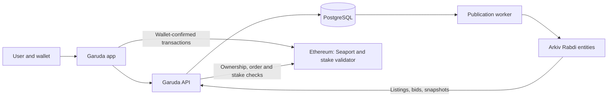

# WiseOne: Garuda

**Unlock the value of your WISE stake. Keep the stake alive.**

WISE rewards long-term commitment, but needing your capital back early comes at a steep cost. Ending an active stake [penalizes its principal and destroys its shares](https://teal.wise.one/#sec-2-3-5-4), ending its future earnings. Withdrawing accrued interest does not release the principal. A valuable position can leave its owner waiting for maturity or paying to exit.

**Garuda gives that position a market.** Built as a WiseOne extension for transferable Signature NFT stakes, it lets owners list a stake or accept a purchase bid. Buyers take over the existing position: its current shares, remaining reward rights, and original maturity. The seller receives payment; the stake continues. The sale itself triggers no WISE early-end penalty.

**Built around what makes a WISE stake valuable.** Garuda brings principal, remaining shares, unclaimed interest, and time to maturity into the trading decision. Its settlement validator checks the underlying stake against the signed terms, so a buyer’s offer is tied to the position they reviewed. These WISE-specific details are central to both pricing a stake and assessing it as collateral.

**Next: borrow against the stake you want to keep.** Planned lending will let lenders propose loans against individual stakes and owners accept suitable terms. The NFT will secure the loan; repayment will return it to the borrower, while default will give the lender a claim on the collateral. Trading works today; collateralized lending is the next stage.

Arkiv makes signed offers discoverable. Ethereum enforces trade settlement. Together, they give WISE stake owners a way to find counterparties and access capital while preserving the underlying position.

## The stake economy behind Garuda

Garuda builds on an existing pool of capital and staking positions. **Ethereum snapshot: 6 November 2026, 09:43 India time.**

| Metric | Snapshot |
| --- | ---: |
| WISE/ETH Uniswap liquidity, both assets ([pool contract](https://etherscan.io/address/0x21b8065d10f73ee2e260e5b47d3344d3ced7596e), [Uniswap pool](https://app.uniswap.org/explore/pools/ethereum/0x21b8065d10f73ee2e260e5b47d3344d3ced7596e)) | **$126.45 million** |
| LP supply burned to the [zero address](https://etherscan.io/token/0x21b8065d10f73ee2e260e5b47d3344d3ced7596e?a=0x0000000000000000000000000000000000000000) | **99.9973%** — about **$126.45 million** in ownerless liquidity |
| Total WISE staked across the [token protocol](https://etherscan.io/address/0x66a0f676479cee1d7373f3dc2e2952778bff5bd6#readContract) | **68.21 million WISE** · ≈ **$8.24 million** |
| WiseOne Protocol — [Signature stakes](https://etherscan.io/address/0x48791dbdfb38baa58e48329148c321bf33b3c1e1#readContract) | **21.38 million WISE** · **31.34%** of all WISE staked |
| [Signature](https://etherscan.io/address/0x48791dbdfb38baa58e48329148c321bf33b3c1e1#readContract) + legacy [Advanced NFT stakes](https://etherscan.io/address/0xf863a603501fcd30f56dffcb6700a25effefbe94#readContract) | **28.58 million WISE** · **41.90%** of all WISE staked |

The pool held **28,412.91 WETH and 523.19 million WISE**. Burned LP shares cannot be redeemed by an owner; pool reserves still change with swaps. “WiseOne Protocol” refers to the Signature contract; the combined figure also includes Advanced stakes. These figures describe the underlying ecosystem, with USD estimates at the snapshot price. [Sources, exact values and reproducible queries](docs/wise-metrics.md).

## Why the existing stake matters

A stake’s current shares determine its weight in WISE’s reward pool. If WISE's share price has risen, recreating an equivalent position with the same principal, term and bonuses buys fewer shares. An existing stake can hold earning weight that a new stake would cost more to recreate. Buyers can compare that position's remaining shares, rewards, time to maturity and asking price. [How WISE shares work](https://github.com/wise-foundation/wise-token-contracts/blob/master/contracts/StakingToken.sol).

**Signature NFTs make the position transferable. Garuda brings the counterparties together.** The seller can move on, and the buyer takes over the existing stake without restarting its term. This applies to supported NFT stakes; ordinary wallet-bound WISE stakes remain non-transferable. Signature stakes are opened at [stake.wise.one](https://stake.wise.one). [Supported stake contracts](https://github.com/wisetoken/signature-stakes).

A market creates choices, not guaranteed liquidity: a sale needs a buyer, proceeds may be below principal, and future rewards vary. Garuda puts the stake's details in view so both sides can judge the trade.

For the proposed Ethereum Foundation Continuity submission, see [CROPS: independent access when Garuda is unavailable](#crops), including the access paths, runnable tool, and verification evidence.

## Where the project stands

Status as of **6 November 2026**:

| Area | Available now | Next step or boundary |
| --- | --- | --- |
| Wallet and portfolio | External wallet connection; live Signature and Advanced NFT positions; cards and table; principal, interest, maturity, historical yield, and indexed creation links | Creation links depend on indexer coverage |
| Signature marketplace | Listings, purchase bids, buying, accepting bids, and onchain cancellation in WISE; owner/bidder identities; filters, sorting, cards and table | Ethereum mainnet contracts are configured; settlement has been verified on disposable mainnet forks and in [one recorded mainnet purchase](#example-a-completed-ownership-change) |
| Order publication | Signed-order validation, PostgreSQL persistence, automatic Arkiv publication, retries, and entity links | A funded Rabdi publisher is needed for Arkiv writes |
| Market discovery | Arkiv is the default source; an explicit **All orders** catalog shows the service's order book | Ethereum checks determine whether a discovered order can still execute |
| Advanced stakes | Portfolio display and collection-aware infrastructure | Trading stays disabled until a verified Advanced validator deployment is configured |
| Product guides | The Problem and The Solution, including stake ownership and share comparisons | Expand alongside the product |
| Get WISE | ETH, WETH, USDC and DAI swaps into WISE through Uniswap v2; balances, quotes, slippage limits and wallet confirmations | Mainnet transaction execution requires the connected owner’s approval; Flash/TWAP is not enabled |
| Lending | Navigation and page structure | Borrower requests, lender offers, collateral, repayment, and default handling are planned |
| CROPS | Independent backup HTML; direct Arkiv order recovery and export; cancellation, permission revocation, and matured Signature redemption | External wallet and reachable Ethereum RPC required; private reads are not enabled |
| Homepage | Initial concept page at `/` | Full homepage comes after the app flows |

The marketplace is under active development. Local integration evidence and fork tests are documented below; they do not establish a public launch or a completed security audit.

## How a stake trade works

### List and buy

1. The owner chooses a stake, sets an asking price and expiration, approves the NFT if needed, and signs a Seaport listing. The asking-price input starts from the stake's principal and remains editable.
2. The API validates and stores the signed order, then queues its publication to Arkiv. Signing a listing does not transfer the NFT.
3. A buyer reviews the stake, asking price, and fee breakdown. They approve the exact WISE amount if needed, then confirm the purchase in their wallet.
4. Seaport and the stake validator settle the exchange on Ethereum: the buyer receives the NFT, the seller receives WISE less the configured fee, and the stake continues with its existing terms.

### Place and accept a bid

1. A prospective buyer chooses a WISE bid amount and expiration, approves WISE if needed, and signs a purchase bid.
2. The bid appears in **Purchase bids**, with the bidder's identity and expiration.
3. The stake owner reviews the proceeds, approves the NFT if needed, and accepts the bid. The owner does not need a WISE balance to accept.
4. Settlement transfers the bidder's WISE and the owner's NFT in one transaction.

Bids do not escrow or reserve funds. Execution still requires the bidder's balance and allowance, the correct NFT owner and stake state, and an unexpired, uncancelled order. Expiration stops an order being filled; removing it from a discovery service is not an onchain cancellation.

### Example: principal and asking price are different

Suppose an active Signature Stake has **1,000 WISE principal** and its owner asks **1,100 WISE**. At the currently configured **0.5% marketplace fee**:

| Settlement item | Amount |
| --- | ---: |
| Buyer pays | 1,100 WISE |
| Marketplace fee | 5.5 WISE |
| Seller receives | 1,094.5 WISE |
| Principal remaining inside the stake | 1,000 WISE |

The buyer receives the existing NFT position and its remaining rights. The sale does not withdraw its principal, reset maturity, or create new shares. Ethereum gas is separate.

Alternatively, a buyer could offer **950 WISE**. If the owner accepts, the fee is **4.75 WISE** and the owner receives **945.25 WISE**. These 1,000 and 950 WISE figures are illustrative. The deployment manifest determines the actual fee and permitted contracts. A reported mainnet settlement at the same **0.5%** fee follows.

### Example: a completed ownership change

[This Ethereum transaction](https://etherscan.io/tx/0xa8f2c8485561e5908b2262dce110a256561bed616b0ef2d94bbba1b018c296f2) filled the published Signature Stake **#20** listing for **20 WISE** on **6 November 2026 at 12:12:35 UTC (17:42:35 India time)**, in block [26,355,734](https://etherscan.io/block/26355734). The buyer called Seaport 1.6 `fulfillAdvancedOrder`. The receipt succeeded.

| Settlement item | Result |
| --- | --- |
| Buyer [`0x641AD78BAca220C5BD28b51Ce8e0F495e85Fe689`](https://etherscan.io/address/0x641AD78BAca220C5BD28b51Ce8e0F495e85Fe689) paid | 20 WISE |
| Marketplace fee to [`0xB8d92F2E8D1A98c18cDe85e49a0F11e3c64D0a68`](https://etherscan.io/address/0xB8d92F2E8D1A98c18cDe85e49a0F11e3c64D0a68) | 0.1 WISE |
| Seller [`0x22079A848266A7D2E40CF0fF71a6573D78adcF37`](https://etherscan.io/address/0x22079A848266A7D2E40CF0fF71a6573D78adcF37) received | 19.9 WISE |
| [Signature NFT #20](https://etherscan.io/nft/0x48791dbdfb38baa58e48329148c321bf33b3c1e1/20) | Transferred from the seller to the buyer |

The stake validator emitted `SaleValidated` for order `0x2a33b8001857cec5a80157b059c253ebc8976cc4b23ac17d5042f297bae2a2af` and set the ownership epoch for token 20 to **1**. The receipt records that NFT transfer and the two WISE payments. It contains no WISE `StakeEnd`, so the underlying stake continued under the new owner. This is the Signature Stake #20 listing in [Live publication examples](#live-publication-examples).

## Technology and data flow

| Layer | Technology | Role |
| --- | --- | --- |
| Interface | React 19, TypeScript, Vite, React Router, Lucide | App screens, trade reviews, stake cards, tables, and navigation |
| Client data | TanStack Query | Portfolio and market queries, caching, and refresh after transactions |
| Wallets | Thirdweb | Wallet connection and user-confirmed signatures/transactions |
| Ethereum | viem, WISE and Signature contracts, Seaport 1.6, stake validator | Contract reads, signed orders, validation, and atomic settlement |
| API | Node.js, Hono | Deployment configuration, order publication, discovery, and stake details |
| Durable storage | PostgreSQL | Signed orders, original publication blocks, indexed state, and retry queue |
| Shared discovery | `@arkiv-network/sdk` on Rabdi | Expiring listings and bids, public entity queries, and short-lived stake snapshots |
| Verification | Node test runner, tsx, Foundry Anvil | Unit tests and isolated Ethereum fork/API checks |



Ethereum remains the authority for ownership, approvals, cancellation, and settlement. PostgreSQL retains the original publication block used to reject signatures after an NFT is transferred away and back. Arkiv makes signed offers publicly queryable with a lifetime that fits the offer; it does not hold funds or replace settlement checks.

The [Signature deployment manifest](scripts/fixtures/signature-market.json) records Ethereum chain ID **1**, contract addresses and code hashes, fee settings, and confirmation policy. Browsing or connecting a wallet does not execute a trade. Signed orders are saved locally before publication so an API failure does not lose access to cancellation.

## Sponsors and ecosystem integrations

The implemented Arkiv integration targets the [ETHGlobal Mumbai Build on Arkiv track for existing projects](https://ethglobal.com/events/mumbai/prizes/arkiv). Users publish listings and bids to Arkiv and discover them through the Market. The [CROPS upgrade](#crops) targets the Ethereum Foundation's existing-project prize: users can manage supported positions and cancel orders without Garuda's application services. These are proposed submission targets, subject to Continuity eligibility.

| Integration | Current role | Status |
| --- | --- | --- |
| [Arkiv](https://docs.arkiv.network/) | Expiring order discovery and reusable stake snapshots | Implemented; Rabdi writes and user-facing reads verified |
| [EF CROPS](https://ethglobal.com/events/mumbai/prizes) | Independent Signature recovery, cancellation, permission revocation and matured redemption | Implemented; live read and fork execution evidence recorded; submission video and eligibility not yet established |
| Nym / Anon-RPC | Optional private Ethereum reads | Present in the earlier prototype; not enabled in this repository yet |
| [Swarm](https://docs.ethswarm.org/) | Artwork snapshots on Swarm, discoverable through separate Arkiv references | Integration prepared and tested with fixtures; disabled pending Bee, funded postage and a live retrieval demonstration. [Setup and limits](docs/swarm-artwork.md) |

Thirdweb, viem, and Seaport are implementation dependencies. Their use here does not imply sponsorship or endorsement.

### Arkiv entities and ownership

The integration uses **Rabdi testnet, chain ID `7794095`**:

| Schema | Contents | Lifetime |
| --- | --- | --- |
| `wiseone.garuda.orders.v2` | Signed listings and bids with indexed price, currency, principal, shares, stake type, maturity, parties and Ethereum block provenance | Initial storage follows the signed trading deadline (1, 3, 7 or 30 days); storage can be extended separately |
| `wiseone.garuda.stakes.v1` | Temporary display cache of stake data, not the stake or its offer | Refreshed from Ethereum as needed: observations usable for five minutes; stored cache copy expires after 15 minutes |
| `wiseone.garuda.media.v1` (optional, not enabled yet) | Swarm artwork/metadata references, SHA-256 checksums and Ethereum observation details | 90-day Arkiv reference lifetime; Swarm storage has its own postage-dependent lifetime |

**These are separate timelines.** A stake keeps its Ethereum maturity date, potentially years away. A listing or bid has the maker's chosen trading deadline. Only the disposable display-cache record has a 15-minute storage lifetime; its expiry does not cancel an offer or end a stake. Fresh Ethereum reads replace stale cache data.

The current **Extend offer** modal extends Arkiv storage only. Keeping a listing or bid open for trading longer requires a new deadline signed by its maker (seller for a listing, bidder for a bid). The stake owner cannot extend another person's bid commitment. A dedicated renew/relist flow is not implemented yet; unexpired previous orders must be handled explicitly so users do not accidentally leave multiple valid offers.

Entity writer: **`0x8d5b491D2c843F6B996De1EC66269809138cA60A`**.

This is a dedicated server publisher. It owns the Arkiv entities; the Ethereum maker and stake owner are separate indexed fields. Users authenticate their orders with Ethereum signatures. The app trusts its configured publisher and deployment scope, and switching publisher addresses changes the entity set it reads.

V2 uses exact `u256` values for price, principal and shares, typed addresses for parties and currency, and `u64` timestamps for maturity and expiry. The Market sends price, principal and expiry sorting to Arkiv; the API and CLI also support numeric ranges. Stake metadata records the observed Ethereum block, while current Ethereum checks determine whether the order can execute. V1 records remain readable with duplicate suppression.

Accepted orders and publication requests are stored together. A worker retries temporary failures, tracks the schema version, deduplicates by deployment and order hash, and reads the entity back before marking it published. Pending publication is visible in the catalog. An Arkiv outage is shown explicitly, with an option to use **All orders**.

### Live publication examples

The following existing public signed orders were republished as **v2** and verified on **6 November 2026 at 02:43 UTC (08:13 India time)**:

| Order | Arkiv entity | Publication transaction |
| --- | --- | --- |
| Signature Stake #20 listing, 20 WISE | [View v2 entity](https://rabdi.explorer.arkiv.network/entity/0x42bcdf1507105a321cfb43d6aa14890d8c23507e15ce9f6e642e17991f33b4c8) | [View transaction](https://rabdi.explorer.arkiv.network/tx/0xc1ea6dc7e0b2bc6ae4f757b211dc1bc17b1b5bedce0d011b68e10349419bd31a) |
| Signature Stake #40 listing, 42,000 WISE | [View v2 entity](https://rabdi.explorer.arkiv.network/entity/0x586e6195475e49a9b3bc03fbada5b6eaac2cfdebd874a061aadfc5bc43e73df5) | [View transaction](https://rabdi.explorer.arkiv.network/tx/0xcb01e10e18300ec13015e3e7646a432a5d736332c3d492aa4549ea7a792c2e7d) |
| Signature Stake #20 purchase bid, 15 WISE | [View v2 entity](https://rabdi.explorer.arkiv.network/entity/0x8219b6b1ea667898b94e1c9dde770fa40dcc49fd56862f0354a619f75cce2e1d) | [View transaction](https://rabdi.explorer.arkiv.network/tx/0x2c325e2d097ade2df1fb9e7ad9572cd5d72080ebe3678766feaefa690f8efcc9) |

All three publication transactions returned successful receipts on **Arkiv Rabdi testnet (chain 7794095)**. Their `wiseone.garuda.orders.v2` entities were read back and checked against the original signed orders and fresh Ethereum stake observations. Prices, signatures, deadlines and original publication blocks were preserved. Signature Stake #53's listing was skipped because its current NFT approval check failed.

These transactions publish discovery data. Ethereum settlement is separate: the Signature Stake #20 listing was later purchased in the [ownership-change example](#example-a-completed-ownership-change). Entities expire at the original signed deadlines, so active queries will eventually stop returning them. [Verification evidence](arkiv/evidence.md) records the keys, deadlines, block provenance and runnable queries.

After installing dependencies, run these read-only queries; they do not load a signer:

```sh
npm run arkiv:query
npm run arkiv:query -- listing
npm run arkiv:query -- bid
npm run arkiv:query -- listing --minPrice=20000000000000000000 --sort=price --direction=asc
```

The final example finds listings asking at least **20 WISE**, ordered by price. Queries filter schema, publisher, deployment scope and unexpired deadlines, then return entity keys and the indexed fields. Amount filters use token base units (18 decimals for WISE). An empty result can mean the recorded offers have expired. See [schema and runnable query](arkiv/schema.md), [why Arkiv](arkiv/why-arkiv.md), [user-facing behavior](arkiv/how-you-use-arkiv.md), [reach](arkiv/reach.md), and [integration feedback](arkiv/friction.md).

To inspect existing orders before republishing them, run:

```sh
node --env-file-if-exists=.env.local --import tsx scripts/arkiv-republish.mjs
```

Adding `--publish` writes valid existing orders as v2 using the configured Rabdi publisher. It preserves signatures, prices, deadlines and original publication blocks, verifies receipts and entity read-backs, and skips unavailable orders. Run it with the background publisher stopped; restart the API afterward. Repeating it reuses verified v2 entities.

## Run locally

Requirements: **Node.js 22.12+**, npm, PostgreSQL, an Ethereum RPC endpoint, and a public Thirdweb client ID configured for your app origin.

```sh
npm ci
cp .env.example .env.local
createdb garuda
```

Edit `.env.local` using [.env.example](.env.example). Set `VITE_THIRDWEB_CLIENT_ID`, the database URL, server Ethereum RPC, and deployment manifest. The database must exist; the API creates its tables on startup.

Run the API and app in separate terminals:

```sh
npm run server
```

```sh
npm run dev
```

Open [Market](http://127.0.0.1:3212/garuda/?screen=trade&collection=signature&view=market), [My stakes](http://127.0.0.1:3212/garuda/?screen=stakes), [The Problem](http://127.0.0.1:3212/garuda/?screen=problem), or [The Solution](http://127.0.0.1:3212/garuda/?screen=how).

The development server uses Vite hot module replacement and React Fast Refresh. Saving app components or CSS updates the open page automatically, preserving component state where possible; HTML changes reload the page. Keep `npm run dev` running while you work. No rebuild is needed for source edits.

| Configuration | Purpose |
| --- | --- |
| `VITE_THIRDWEB_CLIENT_ID` | Public wallet client identifier |
| `VITE_MAINNET_RPC_URL` | Optional public browser read endpoint |
| `GARUDA_DATABASE_URL` | Server PostgreSQL connection; remote connections require `sslmode=verify-full` |
| `GARUDA_RPC_URL` | Server Ethereum RPC |
| `GARUDA_DEPLOYMENT_FILE` | Verified market deployment manifest |
| `GARUDA_MARKET_API_ORIGIN` | Development/preview market proxy, default `http://127.0.0.1:3213` |
| `GARUDA_API_ORIGIN` | Pricing and stake-indexing proxy, default `http://127.0.0.1:3202` |
| `ARKIV_PUBLISHER_ADDRESS` | Publisher trusted by discovery |
| `ARKIV_PUBLISHER_PRIVATE_KEY` | Server-only Rabdi writer; leave empty for read-only discovery |
| `ARKIV_ACCESS_KEY` | Recommended server-side Arkiv access key from the [Arkiv hub](https://hub.arkiv.network/access-keys) |

Arkiv publication needs a dedicated publisher funded with Rabdi test tokens. Browser `VITE_` variables are public: never put private keys or private API credentials in them or commit `.env.local`.

**The pricing and stake-indexing service is a separate dependency.** This repository's API serves `/api/garuda` and `/api/garuda/advanced`; other `/api` requests still use the configured WiseOne pricing/indexing service. A fresh checkout does not start that service. Without it, indexed creation links and price estimates may be unavailable.

For a local production-build preview:

```sh
npm run build
npm run preview
```

Open [the build preview](http://127.0.0.1:3214/garuda/). This serves the last build and does not hot reload; use `npm run dev` on port `3212` while editing. A production host must provide equivalent API routing and run the market service separately; Vite's proxy is not part of the static build.

## Verification

```sh
npm test
npm run typecheck
npm run build
```

The test suite covers order construction and validation, trade workflows, presentation, and Arkiv schemas, expiry, publication, and reads. Browser checks and actual Rabdi publication are recorded in [the evidence document](arkiv/evidence.md).

For settlement checks against deployed contracts, start a disposable Ethereum fork with Foundry's Anvil in another terminal:

```sh
anvil --fork-url https://ethereum-rpc.publicnode.com --chain-id 31337 --host 127.0.0.1 --port 18749 --silent
```

Then run:

```sh
npm run test:market:fork
createdb garuda_test
npm run test:market:api
```

The fork test buys and accepts bids on active and matured Signature Stakes. It verifies buyer debits, seller proceeds, fees, NFT ownership, unchanged underlying stake state, the Thirdweb-to-viem adapter, and rejection of replayed, cancelled, expired, unfunded, and wrong-owner fills.

The API test publishes listings and bids through the route handlers, reconnects PostgreSQL to check durable orders and publication requests, settles both order kinds on the fork, and checks their indexed status. It uses a temporary database schema and never publishes its test orders to Arkiv.

These tests accept a loopback Anvil endpoint on chain **31337**, use generated test accounts, and revert fork changes afterward. They do not use the browser wallet or execute mainnet transfers. `GARUDA_FORK_RPC` can select another loopback port; `GARUDA_TEST_DATABASE` can select an existing local PostgreSQL database. Stop the disposable fork when finished. If the upstream RPC cannot serve the fork's historical state, restart at the latest block or use an archive-capable provider.

## What comes next

The application comes first. The next phase strengthens market reliability, public deployment configuration, dependency review, and transaction feedback while retaining both direct purchases and accepted bids.

Get WISE now supports direct Uniswap v2 funding. Lending next adds borrower requests and stake-specific lender offers, with explicit collateral custody, repayment, expiration, and default behavior. Signing and funding those loans will require verified contracts and settlement tests before being enabled.

CROPS now provides independent backup access for Signature stakes. Private Ethereum reads and wider stake support remain future work. Advanced trading follows its validator configuration. The full homepage and broader product presentation come after these application foundations. The optional Swarm artwork integration is prepared; real uploads and retrieval still need infrastructure and live verification.

## CROPS

**Submission target:** Ethereum Foundation — **Best CROPS Upgrade to an Existing Project**, Continuity Track. See the [official prize criteria](https://ethglobal.com/events/mumbai/prizes).

**Lead property: censorship resistance through independent access to existing positions and permissions.** A user who keeps the backup tool can cancel Signature orders, remove market permissions, or redeem a matured Signature stake even if Garuda's domain and API become unavailable or refuse service. They can choose a different Ethereum read provider and optionally recover published orders directly from Arkiv. Garuda does not need to approve, relay, or host those actions.

**C:** The normal market depends on our domain/API, configured Arkiv publisher, and RPC services; the saved tool removes our domain/API from the exit path, and file/counter cancellation also works without Arkiv. Users still need their external wallet, a reachable Ethereum RPC, and gas; wallet submission RPC settings are separate from the tool's read provider.

**O:** [MIT licensed](LICENSE); `npm ci && npm run build:backup` builds the tool from this repo without application API keys or a backend, using the committed lockfile. Dependencies must be obtainable; running the full market additionally needs the documented services.

**P:** The standalone tool has no trackers or analytics; chosen Ethereum/Arkiv RPCs see IP and queried addresses, and the external wallet sees accounts and requests. The normal market also exposes order/query and authentication metadata to its API, indexing/pricing and wallet providers; public orders are intentionally public, and reads are not anonymous.

**S:** Keys remain in the external wallet, imported files stay on-device, and the tool checks contracts, account, ownership/maturity, simulation and receipt results. Users still trust the wallet, RPC answers, downloaded build and deployed contracts; embedded/social wallets in the full app have separate provider-managed authentication and recovery dependencies.

### Application access and independent access

| User situation | Application-dependent path | Garuda independent access |
| --- | --- | --- |
| Garuda's domain or API disappears | The full application used its hosted frontend and service; cached configuration supported some API-outage cancellation | A saved HTML file includes the interface, code and pinned contracts, and runs from a fresh local origin without Garuda configuration or login |
| An order is missing from the current browser | Orders were saved locally; ordinary Arkiv discovery went through the market service | The tool reads live published v1/v2 orders directly from Arkiv, verifies signatures and Ethereum status, and exports the maker's orders |
| The user needs to withdraw market authority | Managing Seaport and token permissions depends on an available interface | Individual order cancellation, WISE/NFT permission removal, and counter invalidation share the independent interface and verification flow |
| A Signature stake has matured | The deployed contracts already supported redemption | The saved tool reads the stake from Ethereum, rejects early ending, and verifies NFT burn and WISE receipt without the application services |

Garuda’s marketplace, Arkiv integration and independent access tool were developed during ETHGlobal Mumbai. The table compares access paths within that work; it is not a pre-event feature inventory. Garuda reuses WiseOne’s existing staking contracts and application foundations, and uses Seaport for settlement. The contribution is the new application and its integrated trading, discovery and recovery flows, rather than new staking or settlement protocols.

### Why the upgrade matters

The user's ability to exit no longer depends on keeping Garuda's application running. Arkiv adds a useful recovery source: an already-published signature can be retrieved without our database or API and checked before cancellation. Arkiv is optional for the exit path, so its outage, record expiry, or publisher censorship does not disable saved-file or counter cancellation.

This submission claims independent access for supported Signature positions. It does not claim a fully autonomous marketplace, permanent Arkiv storage, anonymous reads, lost-key recovery, or removal of wallet/Ethereum dependencies. The rest of WiseOne is outside this release's verification scope. EF-specific tooling is not required for this property; Anon-RPC and the alt mempool are not presented as implemented integrations.

### Optional artwork resilience: prepared, not live yet

The new [Swarm integration](docs/swarm-artwork.md) adds another storage path for generated WiseOne NFT artwork. Previously the renderer was served through the project's metadata service. When enabled, Garuda queues artwork snapshots for accepted listings and bids, uploads the SVG and metadata to Swarm, verifies retrieval, and publishes their references on Arkiv. The **Artwork backup** viewer can switch gateways and export those references. The artwork renderer is reused existing work; the upload, reference publication and verification path are new.

This can preserve an artwork snapshot when the original metadata service is unavailable. The original NFT `tokenURI` stays unchanged, and the snapshot does not determine ownership or trade eligibility. Initial publication still depends on our worker and publisher; subsequent retrieval needs a working Swarm gateway and retained data, not our image server. Arkiv references expire after 90 days, Swarm retention depends on funded postage, and gateway reads reveal IP addresses and file references. Uploads are disabled until infrastructure is configured; no live Swarm availability or bonus qualification is claimed yet.

### Evidence for judging

See the [integration struggle log](docs/struggles.md) for observed Arkiv failures, diagnostics, fixes, and remaining infrastructure dependencies.

| Judging consideration | Implementation and recorded evidence |
| --- | --- |
| End-to-end behavior | The [fork verifier](scripts/verify-backup-fork.mjs) recovers an Arkiv-format order, checks its signature/state, exports/imports it, cancels it and proves previously executable settlement now fails. It also checks permission removal and matured redemption. |
| Works without the operator | The [standalone build](scripts/build-backup.mjs) embeds code/styles/configuration and excludes application/server and wallet SDK imports. Exit actions use the wallet and Ethereum directly; the fork flow rejects non-fork HTTP calls. |
| Other CROPS properties and trade-offs | The four-letter disclosure and recipient table below describe public data, RPC trust, key custody and remaining services. [Build-time telemetry removal](scripts/no-analytics.ts) covers the pinned client SDK integrations. |
| Usable without CROPS terminology | The interface offers **Find my published orders**, **Review cancellation**, permission removal and matured redemption, with wallet review before transactions. [The in-app page](src/pages/BackupAccessPage.tsx) provides download and export entry points. |
| Can ship after the event | The [HTML artifact](public/garuda-backup.html), [checksum](public/garuda-backup.sha256), lockfile, build command and automated checks are included. Release distribution, wallet-browser rehearsal and the documented dependency review remain relevant to shipping. |

The recorded verification on **6 November 2026** includes 96 passing tests, TypeScript and production builds, a live public-Rabdi read of a listing and incoming bid with Ethereum verification, and a disposable Ethereum fork exercising cancellation and redemption. Live discovery and fork transactions are separate evidence: no live transaction was submitted by those checks, and the fork's Arkiv response was synthetic. Browser layout checks did not exercise an actual wallet extension. See [commands, receipts and verification limits](docs/backup-access.md#automated-verification).

The decisive video moment should be visible: Garuda's domain/API and original read provider are blocked; a saved copy opens from a fresh local origin, connects to an external wallet, uses a working provider, and completes a supported action with its result shown. The [three-minute demonstration script](docs/backup-access.md#three-minute-beforeafter-demonstration) describes the sequence. A fork recording must be labeled as such; the current CLI evidence is not a completed video.

The submission is not yet represented as qualified or complete. Continuity acceptance, the eligible baseline, public repository access, the required video of at most three minutes, and the no-tracker requirement across the submitted client still need to be established. The README's privacy disclosure does not waive that requirement. A public mirror is not claimed; users currently need a saved or independently obtained copy. Submission work is tracked in beads (`garuda-fo4`). Only one EF prize can be awarded to this project under the published rules.

### Independent backup access

Open **CROPS** in Garuda to download the tool and export saved Signature orders. The tool can also be built without any configured application services:

```sh
npm ci
npm run build:backup
python3 -m http.server 8080 --bind 127.0.0.1 --directory public
```

Open [the local backup tool](http://127.0.0.1:8080/garuda-backup.html) in a browser with an external wallet. Download and keep the file before an outage, or obtain the same verified build from someone else. It contains its own scripts and styles; direct `file://` access may not support wallet injection. This is independent frontend access, not offline Ethereum or lost-key recovery.

The tool supports individual cancellation from direct Arkiv discovery or an imported order backup, broad Seaport 1.6 counter invalidation without a backup, WISE allowance removal, Signature collection/token permission removal, and redemption of matured Signature NFTs. It does not provide new trades, early stake ending, Advanced redemption, loans, or ordinary WISE stake redemption. Revoking permission does not cancel a signature; broad counter invalidation affects other apps using the same Seaport deployment. Order backups contain signatures and should be kept private while executable.

**Find my published orders** queries Rabdi directly under the pinned publisher and deployment, supports v1/v2 records, verifies maker signatures (EOA or ERC-1271), and checks Ethereum order hashes, counters, cancellation/fills and signed deadlines. It separates your listings/bids from incoming bids and exports only your verified orders. A custom Rabdi endpoint is available; no publisher key is shipped. Search is explicit, capped at 50 records per schema, and reports malformed records, verification failures, truncation and partial outages.

Discovery only finds live, published records. The publisher can omit or delete records, and expiry removes them from queries; the RPC can also omit results. A missing result never proves that no order exists. Exported files and current-counter cancellation preserve an exit without Arkiv. A verified signature and uncancelled status do not establish trade eligibility: the normal market's original publication anchors, transfer history, ownership and asset checks still apply. The standalone tool does not execute new trades.

Arkiv storage lifetime and signed trading deadlines are separate. The installed SDK 1.0.1 offers `ExpirationTime.max()` (7,884,000 blocks, about 182 days) and extension **before** expiry, not a permanent-storage method. Current publication retains the original signed deadline. Ongoing renewal would need funding and an available renewer; it is not operator-independent permanence. See [Arkiv expiration](https://docs.arkiv.network/writing/expiration/).

The chosen read RPC is separate from the wallet's submission RPC. A failed read endpoint can be changed in the tool; a failed wallet endpoint must be changed in the wallet. The tool never automatically broadcasts transactions to additional providers. After submission, it retains the transaction hash locally and blocks another action until the transaction is resolved. A lost wallet response before the hash is returned remains a wallet-level ambiguity: inspect wallet activity before retrying.

`npm run build` also rebuilds the standalone file. `public/garuda-backup.sha256` identifies the exact artifact. Tests build twice and compare bytes; this proves repeatability in the tested environment, not yet reproducibility on every operating system. A checksum from the same compromised download source is not an independent trust anchor. See [backup verification and demonstration](docs/backup-access.md).

### Who receives information

| Recipient | Normal Garuda application | Standalone backup tool |
| --- | --- | --- |
| Garuda host/API | Connection metadata; requested wallet/stake data; signed listings and bids | No requests |
| Ethereum RPC | Calls, addresses, transaction metadata and source connection | Same for the selected RPC; reads are direct, not anonymized |
| Arkiv/publisher | Public signed orders, maker/stake fields and publication metadata | Optional direct Rabdi reads expose IP and queried wallet to the chosen RPC; no publisher API or signing key |
| Swarm / Bee / selected gateway (optional) | Public generated artwork and metadata, NFT/order identifiers and block provenance; gateway sees reader IP and file reference. Bee upload credentials remain server-only | No Swarm requests; downloaded artwork references can be used separately |
| WiseOne pricing/indexer | Requested pricing or stake-index information and connection metadata | No requests |
| Thirdweb / social login / embedded wallet services | Wallet-service and authentication requests; third-party custody/recovery assumptions apply to embedded wallets | No SDK, login, or requests |
| External wallet / its RPC | Connected accounts, requested signatures/transactions, RPC metadata | Same; keys remain under the external wallet's custody |

The Garuda build removes Thirdweb's connection/transaction analytics sender and disables WalletConnect telemetry. Compilation fails if either pinned SDK integration changes. The standalone bundle excludes both SDKs entirely. This does not assert that provider-hosted authentication pages or the separate legacy WiseOne website are tracker-free; the latter still needs its own analytics cleanup before being included in a whole-site claim.

The normal app retains optional email/social wallets for familiar onboarding. Those flows send authentication identifiers to Thirdweb and the selected identity provider and rely on their wallet/recovery services; they are not claimed to keep all personal or recovery data exclusively on-device. Use an external wallet for the independent tool. Submitted order signatures and addresses are intentionally public so counterparties can discover and settle offers; the app never requests an external wallet's seed or private key.

The [implementation plan](history/PLAN.md) explains sequencing and design decisions. Issue status is tracked with beads.

## Repository map

| Path | Contents |
| --- | --- |
| `src/pages/` | Portfolio, Market, guides, and upcoming feature screens |
| `src/components/` | App shell, stake cards, tables, and trade dialogs |
| `src/lib/` | Wallets, Ethereum readers, signed orders, and market workflows |
| `server/market/` | API routes, validation, storage, indexer, Arkiv publication, and snapshots |
| `scripts/` | Queries, tests, fork verification, and deployment fixture |
| `arkiv/` | Entity schema, sponsor rationale, feedback, reach, and evidence |
| `history/PLAN.md` | Implementation sequence |
| `garuda/index.html` | Application entry point |
| `index.html` | Initial homepage concept |

## Continuity scope, license, and AI assistance

Garuda was developed during ETHGlobal Mumbai as a new extension of WiseOne. It reuses existing WiseOne staking code, portfolio-reading logic and UI foundations from `vitenix`. The Garuda marketplace, Arkiv publication and discovery, and independent access workflows were built during the hackathon, including work developed in parallel and brought together in `garuda-full`.

The current app publishes orders under `wiseone.garuda.orders.v2`, reads `wiseone.garuda.orders.v1` for compatibility, and uses `wiseone.garuda.stakes.v1` for display snapshots. It implements automatic durable publication for listings and bids, retries and deduplication, default Arkiv discovery, entity links, validation tests, and reproducible evidence. Existing public signed orders were used for Rabdi verification; those checks did not create new mainnet orders or transfers.

The existing foundation is WiseOne’s staking application; the hackathon contribution is the Garuda extension described here. Submission acceptance and supporting evidence are tracked separately. Measured user and volume data have not yet been supplied; see [reach](arkiv/reach.md).

Released under the [MIT License](LICENSE).

OpenAI Codex assisted with implementation, refactoring, tests, documentation, and local verification. The project owner directs the work and reviews changes; AI-assisted commits include Codex co-authorship.
