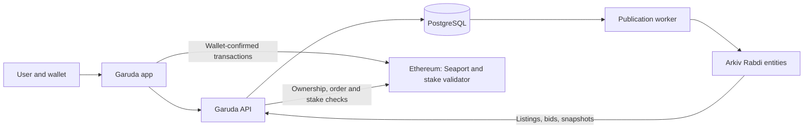

# WiseOne | Garuda Extension

**A new owner. The same stake.**

Garuda is a marketplace for WiseOne NFT stakes on Ethereum. Owners can list a stake for sale or accept a purchase bid. Buyers acquire the existing position, including its remaining rights and original maturity, without restarting its staking term.

The next part of the product is stake-backed lending: owners borrowing against a specific stake and lenders offering terms for that position.

This repository contains the application, market API, Arkiv integration, and verification tools. The current focus is the working marketplace; funding, lending, privacy tools, and the homepage follow in separate steps.

## Why Garuda exists

A WISE stake commits principal for a chosen term. Ending an active stake early deducts a principal penalty and stops its future earnings. Waiting until maturity avoids that early-end penalty. A standard WISE stake belongs to the wallet that created it and cannot simply be transferred to another person.

Shares determine a stake's weight in the daily WISE reward pool. If the protocol's share price rises, equal principal with equal term and referral bonuses buys fewer new shares. An earlier stake can therefore retain more earning weight than an otherwise equivalent new stake. Age alone is not the advantage: remaining shares, remaining earning days, previous interest scraping, and the price paid all matter. Historical annualized yield is not a fixed future rate. See the [WISE staking contract](https://github.com/wise-foundation/wise-token-contracts/blob/master/contracts/StakingToken.sol).

Garuda trades **supported NFT stakes**. A Signature Stake represents ownership of an underlying staking position; selling that NFT changes its owner without ending the stake. Garuda does not retroactively turn ordinary wallet-bound stakes into transferable NFTs. The [Signature stake contracts](https://github.com/wisetoken/signature-stakes) describe the supported collections and rights.

For an owner, this creates another way to access value before maturity. For a buyer, it creates a way to acquire an existing position. A sale still needs a willing buyer, and its proceeds can be below principal. The app explains these trade-offs on its **The Problem** and **The Solution** pages.

## Where the project stands

Status as of **6 November 2026**:

| Area | Available now | Next step or boundary |
| --- | --- | --- |
| Wallet and portfolio | External wallet connection; live Signature and Advanced NFT positions; cards and table; principal, interest, maturity, historical yield, and indexed creation links | Creation links depend on indexer coverage |
| Signature marketplace | Listings, purchase bids, buying, accepting bids, and onchain cancellation in WISE; owner/bidder identities; filters, sorting, cards and table | Ethereum mainnet contracts are configured; settlement has been verified on disposable mainnet forks |
| Order publication | Signed-order validation, PostgreSQL persistence, automatic Arkiv publication, retries, and entity links | A funded Rabdi publisher is needed for Arkiv writes |
| Market discovery | Arkiv is the default source; an explicit **All orders** catalog shows the service's order book | Ethereum checks determine whether a discovered order can still execute |
| Advanced stakes | Portfolio display and collection-aware infrastructure | Trading stays disabled until a verified Advanced validator deployment is configured |
| Product guides | The Problem and The Solution, including stake ownership and share comparisons | Expand alongside the product |
| Get WISE | Navigation and page structure | Funding and swap flow is not enabled in this app yet |
| Lending | Navigation and page structure | Borrower requests, lender offers, collateral, repayment, and default handling are planned |
| CROPS | Navigation and page structure | Recovery tools and optional private Ethereum reads are planned |
| Homepage | Initial concept page at `/` | Full homepage comes after the app flows |

The marketplace is under active development. Local integration evidence and fork tests are documented below; they do not establish a public launch or a completed security audit.

## How a stake trade works

### List and buy

1. The owner chooses a stake, sets an asking price and expiration, approves the NFT if needed, and signs a Seaport listing. The asking-price input starts from the stake's principal and remains editable.
2. The API validates and stores the signed order, then queues its publication to Arkiv. Signing a listing does not transfer the NFT.
3. A buyer reviews the stake, asking price, and fee breakdown. They approve the exact WISE amount if needed, then confirm the purchase in their wallet.
4. Seaport and the stake validator settle the exchange on Ethereum: the buyer receives the NFT, the seller receives WISE less the configured fee, and the stake continues with its existing terms.

### Place and accept a bid

1. A prospective buyer chooses a WISE bid amount and expiration, approves WISE if needed, and signs a purchase bid.
2. The bid appears in **Purchase bids**, with the bidder's identity and expiration.
3. The stake owner reviews the proceeds, approves the NFT if needed, and accepts the bid. The owner does not need a WISE balance to accept.
4. Settlement transfers the bidder's WISE and the owner's NFT in one transaction.

Bids do not escrow or reserve funds. Execution still requires the bidder's balance and allowance, the correct NFT owner and stake state, and an unexpired, uncancelled order. Expiration stops an order being filled; removing it from a discovery service is not an onchain cancellation.

### Example: principal and asking price are different

Suppose an active Signature Stake has **1,000 WISE principal** and its owner asks **1,100 WISE**. At the currently configured **0.5% marketplace fee**:

| Settlement item | Amount |
| --- | ---: |
| Buyer pays | 1,100 WISE |
| Marketplace fee | 5.5 WISE |
| Seller receives | 1,094.5 WISE |
| Principal remaining inside the stake | 1,000 WISE |

The buyer receives the existing NFT position and its remaining rights. The sale does not withdraw its principal, reset maturity, or create new shares. Ethereum gas is separate.

Alternatively, a buyer could offer **950 WISE**. If the owner accepts, the fee is **4.75 WISE** and the owner receives **945.25 WISE**. These are illustrative calculations, not reported mainnet transactions. The deployment manifest determines the actual fee and permitted contracts.

## Technology and data flow

| Layer | Technology | Role |
| --- | --- | --- |
| Interface | React 19, TypeScript, Vite, React Router, Lucide | App screens, trade reviews, stake cards, tables, and navigation |
| Client data | TanStack Query | Portfolio and market queries, caching, and refresh after transactions |
| Wallets | Thirdweb | Wallet connection and user-confirmed signatures/transactions |
| Ethereum | viem, WISE and Signature contracts, Seaport 1.6, stake validator | Contract reads, signed orders, validation, and atomic settlement |
| API | Node.js, Hono | Deployment configuration, order publication, discovery, and stake details |
| Durable storage | PostgreSQL | Signed orders, original publication blocks, indexed state, and retry queue |
| Shared discovery | `@arkiv-network/sdk` on Rabdi | Expiring listings and bids, public entity queries, and short-lived stake snapshots |
| Verification | Node test runner, tsx, Foundry Anvil | Unit tests and isolated Ethereum fork/API checks |



Ethereum remains the authority for ownership, approvals, cancellation, and settlement. PostgreSQL retains the original publication block used to reject signatures after an NFT is transferred away and back. Arkiv makes signed offers publicly queryable with a lifetime that fits the offer; it does not hold funds or replace settlement checks.

The [Signature deployment manifest](scripts/fixtures/signature-market.json) records Ethereum chain ID **1**, contract addresses and code hashes, fee settings, and confirmation policy. Browsing or connecting a wallet does not execute a trade. Signed orders are saved locally before publication so an API failure does not lose access to cancellation.

## Sponsors and ecosystem integrations

**Arkiv is the implemented sponsor integration**, targeting the [ETHGlobal Mumbai Build on Arkiv track for existing projects](https://ethglobal.com/events/mumbai/prizes/arkiv). Users publish listings and bids to Arkiv and discover them through the Market.

| Integration | Current role | Status |
| --- | --- | --- |
| [Arkiv](https://docs.arkiv.network/) | Expiring order discovery and reusable stake snapshots | Implemented; Rabdi writes and user-facing reads verified |
| Nym / Anon-RPC | Optional private Ethereum reads for the planned CROPS page | Present in the earlier prototype; not enabled in this repository yet |
| [Swarm](https://docs.ethswarm.org/) | Possible persistent content storage alongside Arkiv references | Under consideration for the Arkiv + Swarm bonus; no integration claimed yet |

Thirdweb, viem, and Seaport are implementation dependencies. Their use here does not imply sponsorship or endorsement.

### Arkiv entities and ownership

The integration uses **Rabdi testnet, chain ID `7794095`**:

| Schema | Contents | Lifetime |
| --- | --- | --- |
| `wiseone.garuda.orders.v1` | Signed listing or bid; deployment scope, order hash, maker, stake owner, collection, token ID, and expiry | Follows the signed order deadline |
| `wiseone.garuda.stakes.v1` | Stake display data with Ethereum block provenance | 15-minute entity lifetime; cache reads accepted for at most five minutes after canonical block checks |

Entity writer: **`0x8d5b491D2c843F6B996De1EC66269809138cA60A`**.

This is a dedicated server publisher. It owns the Arkiv entities; the Ethereum maker and stake owner are separate indexed fields. Users authenticate their orders with Ethereum signatures. The app trusts its configured publisher and deployment scope, and switching publisher addresses changes the entity set it reads.

Accepted orders and publication requests are stored together. A worker retries temporary failures, deduplicates by deployment and order hash, and reads the entity back before marking it published. Pending publication is visible in the catalog. An Arkiv outage is shown explicitly, with an option to use **All orders**.

### Live publication examples

The following public signed orders were published to the Garuda namespace and read back during verification on 6 November 2026, India time:

| Order | Arkiv evidence |
| --- | --- |
| Signature Stake #20 listing, 20 WISE | [Listing entity](https://rabdi.explorer.arkiv.network/entity/0x3b43f78444e67a97578e67fe70a7fed914d2a5061642072670b397207c31968d) |
| Signature Stake #40 listing, 42,000 WISE | [Listing entity](https://rabdi.explorer.arkiv.network/entity/0x6e7ca02501fff22985e5f727facdb675f56471d08f21e58c0e55be5f54f13587) |
| Signature Stake #20 purchase bid, 15 WISE | [Bid entity](https://rabdi.explorer.arkiv.network/entity/0x757c37b009ce7f1adee68722660543c832d4ef3e2896bcfb2e0520149094b0f7) |

These links demonstrate **Arkiv publication**, not completed Ethereum purchases. The records expire, so they may no longer appear in active queries. [Verification evidence](arkiv/evidence.md) records their keys, deadlines, and the checks performed.

After installing dependencies, run these read-only queries; they do not load a signer:

```sh
npm run arkiv:query
npm run arkiv:query -- listing
npm run arkiv:query -- bid
```

The query filters schema, publisher, deployment scope, unexpired deadlines, and optional order kind, then returns entity keys and order hashes. An empty result can mean the recorded offers have expired. See [schema and runnable query](arkiv/schema.md), [why Arkiv](arkiv/why-arkiv.md), [user-facing behavior](arkiv/how-you-use-arkiv.md), [reach](arkiv/reach.md), and [integration feedback](arkiv/friction.md).

## Run locally

Requirements: **Node.js 22.12+**, npm, PostgreSQL, an Ethereum RPC endpoint, and a public Thirdweb client ID configured for your app origin.

```sh
npm install --package-lock=false
cp .env.example .env.local
createdb garuda
```

Edit `.env.local` using [.env.example](.env.example). Set `VITE_THIRDWEB_CLIENT_ID`, the database URL, server Ethereum RPC, and deployment manifest. The database must exist; the API creates its tables on startup.

Run the API and app in separate terminals:

```sh
npm run server
```

```sh
npm run dev
```

Open [Market](http://127.0.0.1:3211/garuda/?screen=trade&collection=signature&view=market), [My stakes](http://127.0.0.1:3211/garuda/?screen=stakes), [The Problem](http://127.0.0.1:3211/garuda/?screen=problem), or [The Solution](http://127.0.0.1:3211/garuda/?screen=how).

| Configuration | Purpose |
| --- | --- |
| `VITE_THIRDWEB_CLIENT_ID` | Public wallet client identifier |
| `VITE_MAINNET_RPC_URL` | Optional public browser read endpoint |
| `GARUDA_DATABASE_URL` | Server PostgreSQL connection; remote connections require `sslmode=verify-full` |
| `GARUDA_RPC_URL` | Server Ethereum RPC |
| `GARUDA_DEPLOYMENT_FILE` | Verified market deployment manifest |
| `GARUDA_MARKET_API_ORIGIN` | Development/preview market proxy, default `http://127.0.0.1:3213` |
| `GARUDA_API_ORIGIN` | Pricing and stake-indexing proxy, default `http://127.0.0.1:3202` |
| `ARKIV_PUBLISHER_ADDRESS` | Publisher trusted by discovery |
| `ARKIV_PUBLISHER_PRIVATE_KEY` | Server-only Rabdi writer; leave empty for read-only discovery |
| `ARKIV_ACCESS_KEY` | Recommended server-side Arkiv access key from the [Arkiv hub](https://hub.arkiv.network/access-keys) |

Arkiv publication needs a dedicated publisher funded with Rabdi test tokens. Browser `VITE_` variables are public: never put private keys or private API credentials in them or commit `.env.local`.

**The pricing and stake-indexing service is a separate dependency.** This repository's API serves `/api/garuda` and `/api/garuda/advanced`; other `/api` requests still use the configured WiseOne pricing/indexing service. A fresh checkout does not start that service. Without it, indexed creation links and price estimates may be unavailable.

For a local production-build preview:

```sh
npm run build
npm run preview -- --port 3212
```

Open [the preview](http://127.0.0.1:3212/garuda/). A production host must provide equivalent API routing and run the market service separately; Vite's proxy is not part of the static build.

## Verification

```sh
npm test
npm run typecheck
npm run build
```

The test suite covers order construction and validation, trade workflows, presentation, and Arkiv schemas, expiry, publication, and reads. Browser checks and actual Rabdi publication are recorded in [the evidence document](arkiv/evidence.md).

For settlement checks against deployed contracts, start a disposable Ethereum fork with Foundry's Anvil in another terminal:

```sh
anvil --fork-url https://ethereum-rpc.publicnode.com --chain-id 31337 --host 127.0.0.1 --port 18749 --silent
```

Then run:

```sh
npm run test:market:fork
createdb garuda_test
npm run test:market:api
```

The fork test buys and accepts bids on active and matured Signature Stakes. It verifies buyer debits, seller proceeds, fees, NFT ownership, unchanged underlying stake state, the Thirdweb-to-viem adapter, and rejection of replayed, cancelled, expired, unfunded, and wrong-owner fills.

The API test publishes listings and bids through the route handlers, reconnects PostgreSQL to check durable orders and publication requests, settles both order kinds on the fork, and checks their indexed status. It uses a temporary database schema and never publishes its test orders to Arkiv.

These tests accept a loopback Anvil endpoint on chain **31337**, use generated test accounts, and revert fork changes afterward. They do not use the browser wallet or execute mainnet transfers. `GARUDA_FORK_RPC` can select another loopback port; `GARUDA_TEST_DATABASE` can select an existing local PostgreSQL database. Stop the disposable fork when finished. If the upstream RPC cannot serve the fork's historical state, restart at the latest block or use an archive-capable provider.

## What comes next

The application comes first. The next phase strengthens market reliability, public deployment configuration, dependency review, and transaction feedback while retaining both direct purchases and accepted bids.

Funding follows with a Get WISE flow. Lending then adds borrower requests and stake-specific lender offers, with explicit collateral custody, repayment, expiration, and default behavior. Signing and funding those loans will require verified contracts and settlement tests before being enabled.

CROPS adds independent recovery and optional private Ethereum reads. Advanced trading follows its validator configuration. The full homepage and broader product presentation come after these application foundations. Sponsor evidence will expand as integrations gain real usage; Swarm remains a possible addition.

The [implementation plan](history/PLAN.md) explains sequencing and design decisions. Issue status is tracked with beads.

## Repository map

| Path | Contents |
| --- | --- |
| `src/pages/` | Portfolio, Market, guides, and upcoming feature screens |
| `src/components/` | App shell, stake cards, tables, and trade dialogs |
| `src/lib/` | Wallets, Ethereum readers, signed orders, and market workflows |
| `server/market/` | API routes, validation, storage, indexer, Arkiv publication, and snapshots |
| `scripts/` | Queries, tests, fork verification, and deployment fixture |
| `arkiv/` | Entity schema, sponsor rationale, feedback, reach, and evidence |
| `history/PLAN.md` | Implementation sequence |
| `garuda/index.html` | Application entry point |
| `index.html` | Initial homepage concept |

## Continuity scope, license, and AI assistance

The existing product baseline includes WISE NFT stake portfolios, Seaport listings and bids, Ethereum settlement checks, and a manual Arkiv proof of concept with order publication and snapshots under `wiseone.yoda`.

The work documented for the Garuda integration adds `wiseone.garuda` schemas and API routes, automatic durable publication for listings and bids, retries and deduplication, default Arkiv discovery, entity links, validation tests, and reproducible evidence. Existing public signed orders were used for Rabdi verification; those checks did not create new mainnet orders or transfers.

The team still needs to confirm ETHGlobal Continuity acceptance and which changes fall inside the eligible event work window before claiming qualification. Measured user and volume data have not yet been supplied; see [reach](arkiv/reach.md).

Released under the [MIT License](LICENSE).

OpenAI Codex assisted with implementation, refactoring, tests, documentation, and local verification. The project owner directs the work and reviews changes; AI-assisted commits include Codex co-authorship.
